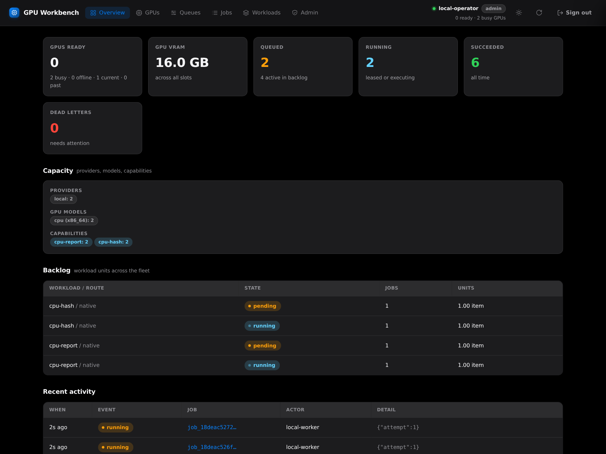

# Distributed GPU

Distributed GPU is an open-source, self-hosted job control plane for running
background compute across your own machines and rented GPU workers.
Submit work once, match it to compatible capacity, and collect validated
results through an API or web workbench.

Use it for independent inference and batch-processing jobs, such as image
generation, transcription, translation, and prompt batches. Each physical GPU
is one schedulable slot: four GPUs can run four unrelated jobs. It is not a
multi-GPU model-training or model-sharding framework.



*The workbench in a local example deployment with two CPU slots, showing
completed jobs, running work, and the remaining backlog.*

The companion worker package is
[distributed-worker](https://github.com/autonomica-xyz/distributed-worker)
(`dworker`, MIT-licensed): a CLI plus loopback dashboard that inventories
NVIDIA, AMD, or spare-CPU capacity on a host, advertises selected
capabilities, optionally gates claiming on confirmed machine idle, and runs
the executors defined here. This repository also ships a minimal `dgpu agent`
loop for headless and pool-deployed workers. Use `dworker` for workstation
controls, idle-aware execution, and a host-local dashboard.

## Videos

| Demo | Duration |
| --- | --- |
| [Controller: queue to delivered image](assets/videos/controller-demo.mp4) | 60 seconds |
| [Distributed GPU + dworker overview](assets/videos/overview.mp4) | 45 seconds |

Captioned recordings show real dashboards and SDXL jobs on one NVIDIA worker,
edited for length—not a latency benchmark. Runtime and model weights are
provisioned separately. [Posters, subtitles, and sharing guide](assets/videos/README.md).

## Features

- **Durable queue** — SQLite-backed jobs, attempts, and events; project-scoped
  idempotency keys; priorities; centrally bounded retries; heartbeat lease
  recovery; cancellation.
- **Precise placement** — atomic claims matched on VRAM, compute capability,
  GPU model, provider, labels, advertised capabilities, and installed model
  packs. One executor loop per physical GPU.
- **Scoped credentials** — role-scoped (`admin`, `client`, `agent`,
  `controller`) tokens with per-route `--scope routes=<workload>` grants,
  expiry, and revocation.
- **Private inputs, validated outputs** — clients upload project-scoped input
  blobs that an agent may fetch only while holding a lease on a job that
  references them; outputs are streamed, bounded, content-addressed, and
  validated against the route's artifact spec.
- **Operator workbench** — a web dashboard at `/dashboard` to watch the fleet,
  inspect and submit jobs, issue tokens, and run provider deploys.
- **Fleet planning** — workload-unit autoscaling math and a read-only
  multi-provider planner (`dgpu plan`); operator-confirmed Vast/Salad deploys
  through pool policy files.

## Workload catalog

`dgpu serve` loads route YAML from `DGPU_WORKLOADS` (default `workloads/`);
`dgpu validate` lists what it parsed, and `GET /v1/workloads` serves the live
catalog. Bundled routes:

| Workload | Backend | Purpose |
| --- | --- | --- |
| [image-generate](workloads/image-generate.yaml) | SDXL / Diffusers | Generate PNG images from bounded prompts and settings |
| [llm-batch](workloads/llm-batch.yaml) | Qwen3.5 9B W4 / vLLM | Process ordered batches of text prompts |
| [transcribe](workloads/transcribe.yaml) | Parakeet or WhisperX | Speech recognition, timestamps, English alignment, optional speaker diarization |
| [translate-batch](workloads/translate-batch.yaml) | Argos / CTranslate2 | GPU text translation using reviewed language packs |
| [translate-segment](workloads/translate-segment.yaml) and [translate-text-batch](workloads/translate-text-batch.yaml) | LibreTranslate | Single-segment and batched translation through a local service |

Routes define the trusted executor, immutable model identity, hardware
requirements, input schema, and output validation. Jobs supply data, not
arbitrary executors, checkpoints, or service endpoints. Add your own routes
for trusted command, container, HTTP, or plugin workloads, including CPU work.

Models and ML runtimes are separate from the controller installation.
Provision verified packs before execution; Hugging Face provisioning checks
the pinned snapshot's LFS/blob identities and writes per-file SHA-256
manifests for offline verification at load time. See [model locks](models/),
the [workload guide](workloads/README.md), and the [transcription](deploy/transcription/requirements.txt)
and [vLLM](deploy/llm/requirements.txt) runtime profiles. Bundled ML routes
target NVIDIA hardware. Model licenses apply separately; a fresh pyannote
diarization-pack download requires approved Hugging Face access.

## Install

Python 3.10 or newer is required. Install from these repositories or a
locally built wheel:

```bash
git clone https://github.com/autonomica-xyz/distributed-gpu.git
cd distributed-gpu
python3 -m venv .venv
.venv/bin/pip install .
.venv/bin/dgpu validate
```

Install `'.[models]'` when this environment also needs model-pack provisioning
tools. GPU libraries and model weights are not installed on the controller.
Workers need the route-specific runtime; `ffprobe` is required for
`media_probe` validation.

## Run the controller

```bash
umask 077
mkdir -p state
.venv/bin/dgpu token --role admin --subject operator \
  --expires-hours 24 > state/operator.token
.venv/bin/dgpu token --role client --subject example-project \
  --expires-hours 24 > state/client.token
.venv/bin/dgpu serve --host 127.0.0.1 --port 8088
```

State lives in `./state/` (`DGPU_DB`, `DGPU_ARTIFACTS`). Open
`http://127.0.0.1:8088/dashboard` and paste the contents of
`state/operator.token` into the sign-in form. Keep token files private.
Disable the workbench with `--no-dashboard` or `DGPU_DASHBOARD=0`.

From another terminal in the controller checkout, issue an agent token for
the worker and workloads you want it to serve:

```bash
umask 077
.venv/bin/dgpu token --role agent --subject image-worker \
  --scope routes=image-generate --expires-hours 24 > state/worker.token
```

Repeat `--scope` per route — do not comma-join values. An agent token may
only register slots and claim work for its subject and routes; never hand a
worker an admin or client token.

## Submit a job

With the controller running, submit through the authenticated API:

```bash
CLIENT_TOKEN="$(cat state/client.token)"
curl --fail-with-body http://127.0.0.1:8088/v1/jobs \
  -H "Authorization: Bearer $CLIENT_TOKEN" \
  -H 'Content-Type: application/json' \
  -H 'Idempotency-Key: image-example-1' \
  --data '{"project_id":"example-project","workload":"image-generate","payload":{"prompt":"A red ceramic mug on a white table","seed":42}}'
```

The response includes a job ID. It remains queued until a compatible worker
with the required runtime and model pack is available. Follow it in the
workbench or with `GET /v1/jobs/{id}`; completed jobs reference downloadable
output artifacts. Workloads declaring file inputs use the project's private
input-upload API before job submission.

## Connecting real workers

On each GPU host, install the
[distributed-worker](https://github.com/autonomica-xyz/distributed-worker)
package (which depends on this one) and run `dworker login` with the
controller endpoint and a route-scoped agent token, then `dworker doctor` to
see which routes the machine matches. A host must already satisfy a route's
prerequisites — the executor/plugin installed, verified model packs on disk,
and any operator-started local model server warm — before advertising its
capability. Model endpoints such as LibreTranslate or vLLM bind to
`127.0.0.1` on the worker and never leave the host.

## Production and provider boundaries

- **Split ingress.** Keep the dashboard and provider-keyed deploy API on a
  private listener. For public workers, put a TLS-terminating reverse proxy
  in front of a second `dgpu serve --no-dashboard` process with no
  `DGPU_PUBLIC_URL`, and verify the boundary with
  `scripts/verify_public_ingress.sh` before renting capacity.
- **Provider keys stay on the controller.** A worker receives only the public
  controller URL, an optional wheel URL, a fixed identity, and a short-lived
  route-scoped agent token — never Vast/Salad credentials.
- **Deploys are operator actions.** `dgpu plan` is read-only; the workbench's
  provider deploys require explicit confirmation. Unattended autoscaler apply
  exists but is off unless `DGPU_AUTONOMOUS_APPLY` is deliberately set.
  Lease or token expiry does not stop provider billing; destroy rented
  resources explicitly when they are no longer needed.
- **No job-selected code.** Executors, images, and models come from routes
  and pool files, not payloads. Fixed local services are started by the
  operator, not spawned by the worker.

## Contributing

See [CONTRIBUTING.md](CONTRIBUTING.md); security reports follow
[SECURITY.md](SECURITY.md).

## License

Copyright (C) 2026 Aljaz Ceru. GPL-3.0-or-later — see [LICENSE](LICENSE).
The companion `dworker` package is MIT-licensed but depends on this
GPL-licensed package, which is distributed separately and retains its
license.
